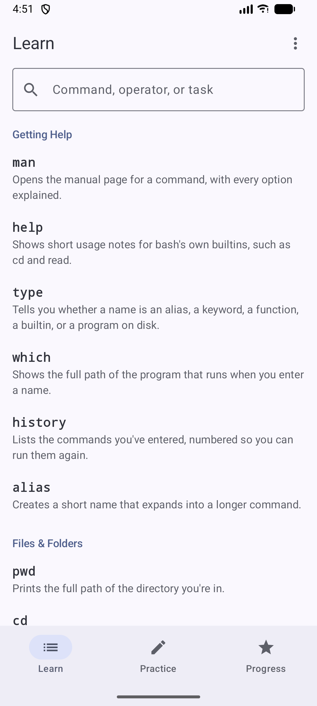

<!-- last_updated: 2026-11-23 -->
<!-- Authoring guidance: dev-docs/specs/README_SPEC.instructions.md -->
<!-- rumdl-disable MD033 MD041 -->

  

<h1 align="center">Bash Practice</h1>

  An app that helps command-line beginners learn everyday bash commands and
  operators and test themselves with quick quizzes.

  
  
  
  

<!-- rumdl-enable MD033 MD041 -->

---

## About

Bash has a long list of commands, options, and symbols, and remembering which
one does what takes practice. Bash Practice gives you a pocket reference of 68
common commands and operators, from getting help and working with files to
text processing, pipes and redirection, processes, scripting, and networking,
along with quizzes that check what you remember. Everything works on your
device, with no account and no shell connection needed. The app runs on
Android phones and tablets and on iPhone and iPad.

## Features

- Browse 68 commands and operators in ten categories, or search by name,
  another spelling, or task.
- Read each command's summary, syntax, examples, and tips, see whether it is
  a shell builtin, a program, or an operator, and copy any example to the
  clipboard.
- Mark commands as learned. Learned commands show a check mark in the list,
  and a quiz can leave them out.
- Take multiple-choice or type-the-command quizzes of 5 to 30 questions on all
  commands, ones you have not learned yet, ones that need review, or a single
  category.
- Answer questions that describe what a command does or a task to get done,
  with typed answers checked case-sensitively, just as bash checks them.
- See your score and the commands you missed at the end of each quiz.
- Practice pipelines: pick the pipeline that does a task, or build it by
  tapping commands into order.
- Quiz yourself on the commands you miss most with the **Needs Review**
  choice.
- Read six short guides, on command conventions, paths and wildcards, quoting
  and variables, piping, redirection, and exit status and chaining, each with
  worked examples and their output.
- Type examples into the emulator to see their recorded output. Nothing you
  type is run.
- Send a bug report or feature request from inside the app.

The next Android and iOS versions, in development, arrange these features in
four tabs: **Home**, **Practice**, **Emulator**, and **Docs**. **Docs** holds
the command list under **Commands** and the guides under **Guides**, with
**Reset All Progress** under **About**. Pipeline rounds in those versions run
from 1 to 14 questions, and the app remembers the length you choose. The
versions available now use **Learn**, **Practice**, **Progress**, and **Docs**
tabs; the [User Manual](docs/USER_MANUAL.md) lists the differences.

## App Screenshot

<!-- rumdl-disable MD033 -->

  
  

<!-- rumdl-enable MD033 -->

The **Learn** tab and a quiz question in version 1.1.0 on Android.

## Download

| Platform | Download | Notes |
| --- | --- | --- |
| Android | [Google Play](https://play.google.com/store/apps/details?id=com.plaintxtoffice.bashpractice) | Version 1.1.0. Requires Android 8.0 or later. |
| iOS | [App Store](https://apps.apple.com/app/id6837567763) | Version 1.0.0; 1.1.0, with the guides and the practice terminal, is waiting for App Review. Requires iOS 17 or later on iPhone or iPad. |

## User Manual

See the [User Manual](docs/USER_MANUAL.md) for installation, setup, usage, and
troubleshooting.

## Feedback

Send bug reports and feature requests to
[support@plaintxtoffice.com](mailto:support@plaintxtoffice.com), through the
[contact page](https://plaintxtoffice.com/contact/), or in
[GitHub Issues](https://github.com/PlainTxtOffice/bash-practice/issues). In the
app, the feedback screen prepares an email to the same address. In Android
1.1.0, find **Send feedback** in **More options** (three dots) on any tab or
under **About** in **Docs**. In iOS 1.0.0 it is in **More options**; iOS 1.1.0
moves it under **About** in **Docs**. The next Android and iOS versions, in
development, add a **Send Feedback** button to the **Home** tab and keep it
under **About** in **Docs**.

## License

Bash Practice is proprietary software owned by Plain Text Office LLC. See
[LICENSE](LICENSE) for the terms; all rights reserved.
