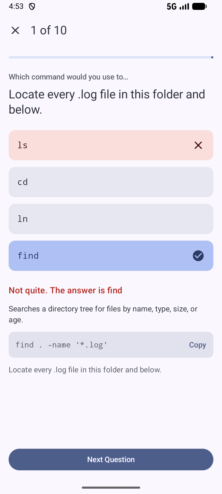

<!-- last_updated: 2026-11-15 -->
<!-- Authoring guidance: dev-docs/specs/README_SPEC.instructions.md -->
<!-- rumdl-disable MD033 MD041 -->

  

<h1 align="center">Bash Practice</h1>

  An Android app that helps command-line beginners learn everyday bash commands
  and operators and test themselves with quick quizzes.

<!-- rumdl-enable MD033 MD041 -->

---

## About

Bash has a long list of commands, options, and symbols, and remembering which
one does what takes practice. Bash Practice gives you a pocket reference of 68
common commands and operators, from getting help and working with files to
text processing, pipes and redirection, processes, scripting, and networking,
along with quizzes that check what you remember. Everything works on your
device, with no account and no shell connection needed. The app runs on
Android phones and tablets.

## Features

- Browse 68 commands and operators in ten categories, or search by name,
  another spelling, or task.
- Read each command's summary, syntax, examples, and tips, see whether it is
  a shell builtin, a program, or an operator, and copy any example to the
  clipboard.
- Mark commands as learned and see your progress overall and by category.
- Take multiple-choice or type-the-command quizzes of 5 to 30 questions on all
  commands, ones you have not learned yet, ones that need review, or a single
  category.
- Answer questions that describe what a command does or a task to get done,
  with typed answers checked case-sensitively, just as bash checks them.
- See your score and the commands you missed at the end of each quiz.
- Practice pipelines: pick the pipeline that does a task, or build it by
  tapping commands into order.
- Track quiz accuracy, with a **Needs Review** list of the commands you miss
  most.
- Send a bug report or feature request from inside the app.
- Reset all progress when you want to start over.

## App Screenshot

<!-- rumdl-disable MD033 -->

  
  

<!-- rumdl-enable MD033 -->

The **Learn** tab and a quiz question on Android.

## User Manual

See the [User Manual](docs/USER_MANUAL.md) for installation, setup, usage, and
troubleshooting.

## License

Bash Practice is proprietary software owned by Plain Text Office LLC. See
[LICENSE](LICENSE) for the terms; all rights reserved.
